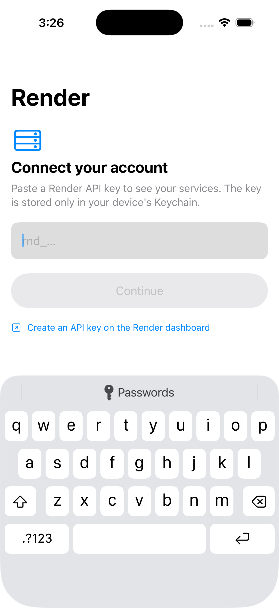
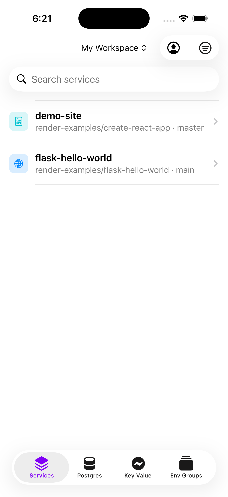
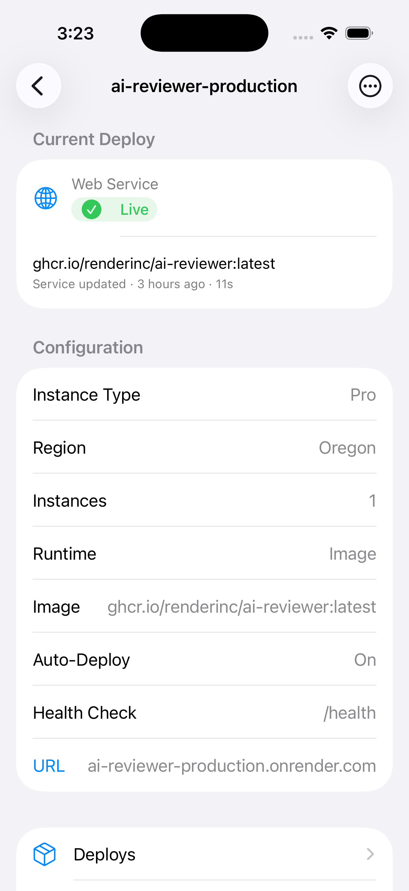
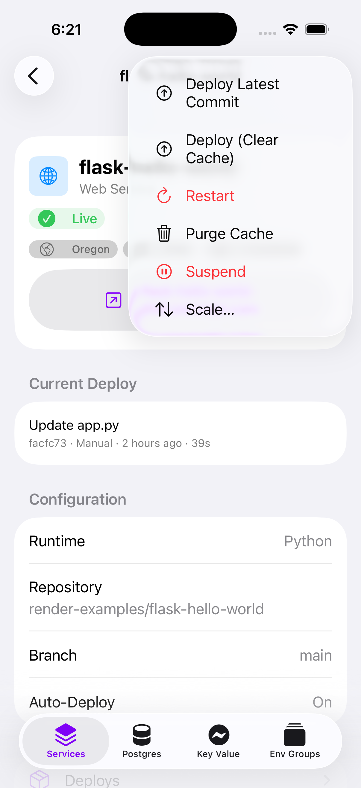
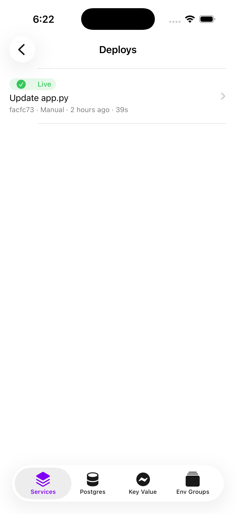
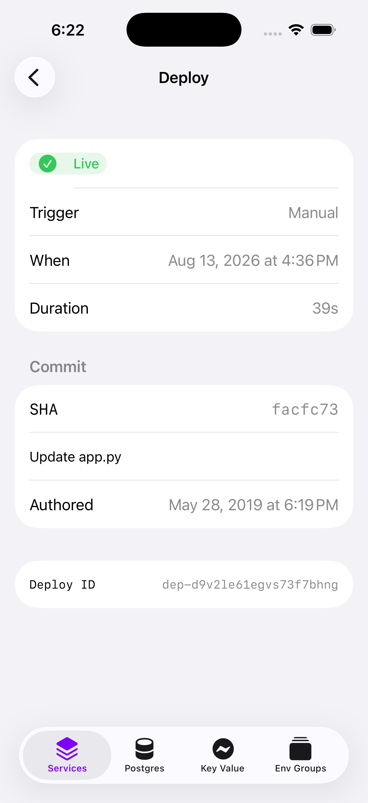
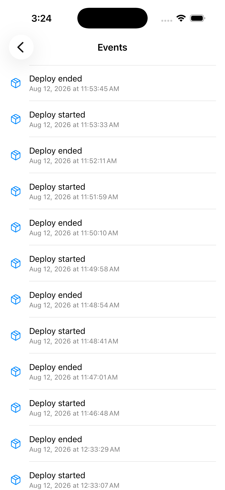
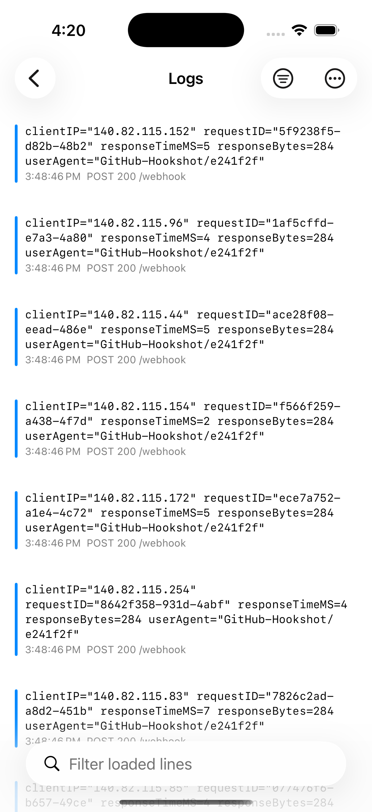
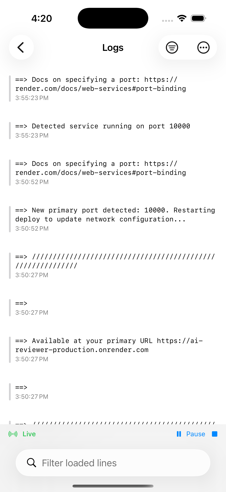
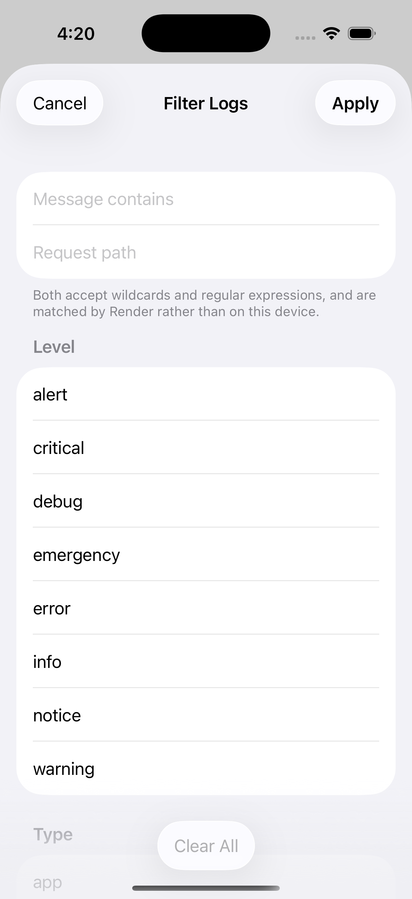

# Render for iOS

A native iPhone app for [Render](https://render.com) — on-call triage and one-tap recovery for your
services, without opening a laptop.

Sign in with a Render API key, browse the services in any workspace or project you belong to, drill
into one to see its current deploy and configuration, walk its deploy history and event timeline,
and run the actions that matter at 3am: deploy, roll back, cancel, restart, suspend/resume, scale,
purge cache, trigger a cron job.

Built with SwiftUI, Swift 6 strict concurrency, and a code-generated client over Render's public
OpenAPI spec. No third-party UI or networking dependencies.

> **Status:** Phases 0–3 are complete (auth, service list, service detail, deploys, events,
> lifecycle actions, and logs with a live WebSocket tail). Metrics and full dashboard parity are
> planned — see [`PLAN.md`](PLAN.md) for the roadmap.

---

## Screenshots

| Onboarding | Service list | Service detail |
|---|---|---|
|  |  |  |
| Paste an API key. It's validated against `GET /owners` and stored in the Keychain — never in `UserDefaults`, never in the repo. | Every service in the active workspace/project, searchable and filterable by type, paging as you scroll. PR previews are excluded. | Current deploy status, then the configuration facts worth knowing on call, then drill-downs. |

| Actions | Deploy history | Deploy detail | Events |
|---|---|---|---|
|  |  |  |  |
| The action set is computed per service: an image-backed service gets "Deploy Latest Image" and no cache-clearing build; a cron job gets "Run Now". Every action is confirmed first. | Newest first, paging as you scroll. Roll back from a leading swipe — full-swipe is disabled deliberately, so a careless thumb can't fire one. | Status, trigger, timing, and the commit or image that shipped. Refetched on open so an in-flight deploy shows current status. | What Render did to this service and when. 42 event types, colour-coded by whether something broke, something is moving, or it's bookkeeping. |

| Logs | Live tail | Log filters |
|---|---|---|
|  |  |  |
| Newest first, paging backwards through the window Render hands back. Severity down the left edge, request logs summarised as `POST 200 /webhook`. Tap a line for its full label set. | A WebSocket tail over `GET /logs/subscribe` — the one endpoint the generator can't express, so it's hand-written. Reconnects with backoff; pause holds lines without dropping them. | The filter set is server-side, and its vocabulary comes from `GET /logs/values` — so it offers the levels and types *this* service actually emits, not a hard-coded list. |

---

## Getting started

**Requirements:** Xcode 26 (Swift 6), an iOS 18+ device or simulator, and a Render API key from
[dashboard.render.com/u/settings/api-keys](https://dashboard.render.com/u/settings/api-keys).

```sh
git clone <this repo>
cd render-ios
make run          # build, install, and launch on the iPhone 17 Pro simulator
```

Paste your API key into the onboarding screen. It's stored in the device Keychain and nowhere else.

```sh
make check        # everything CI runs: tests + build
make test         # both test suites
make test-package # RenderAPI package only — fast, no simulator
make test-app     # app-target store tests — needs a simulator
make build        # build for the simulator
make generate     # re-vendor the OpenAPI spec and regenerate the client
make drift        # regenerate and report whether Render changed the spec
make help         # list targets
```

`SIMULATOR="iPhone 17"` overrides the device for `run`/`build`/`test-app`.

### Optional: live smoke test

`Scripts/smoke.sh` exercises the real API read-only (owners, services, deploys, events) so you can
confirm what the app should be showing:

```sh
cp .env.example .env   # then paste your key into RENDER_API_KEY
Scripts/smoke.sh
```

`.env` is gitignored. Nothing in the repo, the tests, or CI ever holds a key — the app itself only
ever reads the one you type on-device.

---

## How the app works

### Three layers, one direction

```
┌──────────────────────────────────────────────────────────────────┐
│  SwiftUI views          ServicesListView, ServiceDetailView, …   │
│    ▲ reads domain structs, never generated types                 │
├──────────────────────────────────────────────────────────────────┤
│  @Observable stores     ServicesStore, ServiceDetailStore, …     │
│    ▲ maps generated types → ServiceSummary, DeploySummary, …     │
├──────────────────────────────────────────────────────────────────┤
│  RenderAPI package      RenderClient + middleware + Generated/   │
│    ▲ 207 operations generated from the vendored OpenAPI spec     │
└──────────────────────────────────────────────────────────────────┘
```

A view never touches a `Components.Schemas.*` type. Each store owns the mapping into a small
`Sendable` domain struct, so an upstream spec change is absorbed in one layer instead of rippling
through the UI.

### The API layer (`Packages/RenderAPI`)

A local SwiftPM package that is the app target's only dependency. `RenderClient` wraps the generated
client with a fixed base URL and a three-middleware stack — order matters, and it's outermost-first:

| Middleware | Job |
|---|---|
| `StatusMappingMiddleware` | Outermost, so it sees only the *final* response: turns a terminal 4xx/5xx into a thrown `RenderError`. |
| `RetryMiddleware` | Exponential backoff with jitter, honouring `Retry-After` on 429. A 429 is replayed for any method; a 5xx only for idempotent ones, so a failed `POST /deploys` can't ship twice. |
| `AuthMiddleware` | Attaches `Authorization: Bearer <key>`, reading the key per request so a sign-out or workspace switch takes effect immediately. |

Other pieces that earn their place:

- **`Keychain` / `KeychainAPIKeyProvider`** — the API key is the only secret, stored as a generic
  password with `kSecAttrAccessibleAfterFirstUnlock`. Everything non-secret (selected workspace,
  selected project) lives in `UserDefaults`.
- **`CursorPaginator`** — every Render list endpoint returns `{resource, cursor}` envelopes with no
  "hasMore" flag; a short page is the only end-of-collection signal. One generic `AsyncSequence`
  handles all of them, with both a `collect()` (drain everything) and a `firstPage(after:)`
  (page-on-scroll) mode.
- **`RenderDateTranscoder`** — Render sends microsecond-precision timestamps with a varying digit
  count, which `ISO8601DateFormatter` rejects outright. Without this, essentially every response
  fails to decode.
- **`RenderError`** — one enum (`unauthorized`, `forbidden`, `notFound`, `rateLimited(retryAfter:)`,
  `server`, `transport`, `decoding`) so views switch on intent, not on status numbers. Only
  `unauthorized` clears the stored key.
- **`ServiceDetails+Decode`** — see [the `oneOf` problem](#the-oneof-problem) below.

### The stores

Each is `@MainActor @Observable`, owns exactly one screen's state, and is re-created when its scope
changes (SwiftUI `.id(...)` on the view).

| Store | Responsibility |
|---|---|
| `AuthStore` | Validates a key by calling `listOwners` — one round trip proves the key works *and* yields the workspace list. A key is written to the Keychain only *after* it validates, so a typo never displaces a working one. |
| `ProjectsStore` | Drains the owner's projects for the scope picker. Services belong to *environments*, not projects, so a project scope becomes an `environmentId` filter. A failure here is non-fatal — the list just stays workspace-wide. |
| `ServicesStore` | Pages the service list; search and type filtering are client-side over loaded pages. |
| `ServiceDetailStore` | Loads the service and its latest deploy concurrently, owns the lifecycle actions, and **polls while a deploy is in progress** — stopping the moment it settles, so an idle service costs zero requests. |
| `DeploysStore` | Pages deploy history; also the source of `latestDeploy` for the detail header. |
| `ServiceEventsStore` | Pages the event timeline **by time window, not cursor** — the events envelope declares a `cursor` it never defines, so the generator drops it. Each page asks for events older than the oldest one held, de-duplicated by ID. |

### Actions, and the care taken with them

`ServiceAction` is one enum carrying its own confirmation copy, because `Restart` and `Suspend` sit
one row apart in a menu:

- Availability is computed from the loaded service — cron jobs get "Run Now" instead of a deploy;
  cache purge and restart only appear for types that support them; an in-flight deploy adds "Cancel".
- Deploy wording follows the runtime: "Deploy Latest Commit" vs "Deploy Latest Image", because
  telling someone running an image-backed service that you'll build their branch is simply wrong.
- Every action is gated behind a confirmation dialog naming the service and what will happen.
- Rollback is offered only for deploys that actually shipped and aren't the one currently serving,
  and only via a swipe action with full-swipe disabled.
- Outcomes land in a bottom banner rather than an alert — the confirmation already happened, and a
  modal between two consecutive actions is friction for no safety gain.
- After any action, success or failure, the store reloads: these endpoints are asynchronous and the
  local copy is stale the moment they return.

### The generated client

`Packages/RenderAPI/Sources/RenderAPI/Generated/` is **committed** — 207 operations, ~135K lines,
produced by `swift-openapi-generator` from the vendored `openapi.json`. Committing it means an
upstream spec change arrives as a reviewable diff rather than a surprise build break, keeps clean
checkouts free of Xcode's plugin trust prompt, and keeps ~40s of generation off every incremental
build. `Package.resolved` pins the generator and runtime versions that produced it.

`RenderClient` exposes the generated client as `.api` rather than re-declaring 207 methods by hand;
the layer that earns its keep is the store that maps results into domain types.

---

## Working with the spec

Render publishes its OpenAPI spec unversioned and warns that it changes without notice. Three of its
properties actively break naive code generation, and `Scripts/generate-api.sh` works around all
three before the generator ever sees the file:

```
download → jq pretty-print → flatten-path-refs.py → relax-nullable.py → order-oneof.py → generate
```

1. **Unresolvable `$ref`s.** OpenAPIKit only resolves refs into `#/components/…`, and the spec has
   ~250 refs into `#/paths/…`. `flatten-path-refs.py` inlines them. Without this, generation fails
   outright.
2. **Fields marked required that come back `null`.** The generated decoder is strict, so a single
   such field fails the *whole* response — `buildFilter.ignoredPaths` alone broke the service list
   on 66 of 190 real services. `relax-nullable.py` drops those from `required` so they generate as
   optionals. Each entry is a confirmed spec-vs-reality mismatch.
3. **<a id="the-oneof-problem"></a>`service.serviceDetails` is an undiscriminated `oneOf`.** The
   generated decoder tries each member in declaration order and keeps the first that succeeds — so
   the spec's ordering is load-bearing. `cronJobDetails`' requirements are a subset of
   `backgroundWorkerDetails`', which means every cron job would silently decode as a worker.
   `order-oneof.py` swaps them. On the Swift side, `ServiceDetails` reads every field keyed off the
   authoritative `service.type` and records which union member actually decoded, purely so a
   disagreement can be *detected* — the detail screen shows a warning banner rather than presenting
   possibly-wrong configuration as fact.

Two consequences worth knowing before extending the app:

- **Service event details are not readable.** `serviceEvent.details` is a 44-member undiscriminated
  `oneOf` whose second member has *no* required properties, so it matches almost anything and reports
  success. `ServiceEvent` therefore carries only `type` and `timestamp`. (The upside: the union can
  never fail, so events always load.) Making details usable needs a spec patch.
- **The metrics endpoints drop `unit`.** It appears in `required` but not in `properties`, so the
  generator skips it entirely. A metrics feature will have to hard-code units per series.

`.github/workflows/spec-drift.yml` re-runs generation against the live spec every Monday and fails
when the committed output no longer matches. The fix is `make generate` and a review of the diff.

---

## Repository layout

```
App/                      app target (Xcode 26 synchronized folders)
  Assets.xcassets/        app icon (light / dark / tinted)
  Auth/                   API-key onboarding, AuthStore
  Workspaces/             workspace + project scope picker
  Projects/               ProjectsStore
  Services/               list, detail, actions, events
  Deploys/                history, detail, rollback
  DesignSystem/           status chips, type glyphs, shared display mappings
AppTests/                 store tests, transport stubbed
Packages/RenderAPI/       the only dependency surface
  openapi.json            vendored + pinned, post-flatten
  Sources/RenderAPI/
    Generated/            committed generator output
    RenderClient.swift    façade: base URL + middleware stack
    *Middleware.swift     auth, retry, status mapping
    Pagination.swift      generic cursor AsyncSequence
    ServiceDetails+Decode.swift   the oneOf workaround
  Sources/RenderAPITestSupport/   StubTransport, shared by both suites
  Tests/RenderAPITests/
Scripts/                  generation pipeline, smoke test, simulator driver, icon builder
docs/screenshots/
Makefile
PLAN.md                   design rationale, roadmap, and phase outcomes
```

---

## Testing

**`Packages/RenderAPI/Tests`** — `swift-testing` cases over `StubTransport`: `ServiceDetails`
decoding for all five service types, pagination termination, retry backoff on a stubbed 429 with
`Retry-After`, `RenderError` mapping for 401/403/404/429/5xx, date transcoding. No simulator, no
network.

**`AppTests/`** — the `@Observable` stores driven through the *real* generated client with only the
transport stubbed, so a test covers the query a store actually builds rather than a re-implementation
of it.

No test makes a live call: an API key is a user secret and CI runs offline. The stub transport ships
as a package *product* (`RenderAPITestSupport`) because both suites need it.

Running the app tests needs a concrete simulator (`generic/platform=iOS Simulator` builds but can't
run), so `Scripts/test-destination.sh` resolves one at run time rather than pinning a device a CI
image may stop shipping.

CI (`.github/workflows/ci.yml`) runs the package tests, the app tests, and a simulator build on every
PR and every push to `main`, through the same `make` targets used locally.

### Driving the simulator

Screens can be exercised end-to-end without XCUITest:

```sh
make run
swift Scripts/sim-input.swift tap 600 1349     # coordinates read straight off a screenshot
swift Scripts/sim-input.swift drag 600 2200 600 1200
xcrun simctl io booted screenshot /tmp/step.png
```

Both failure modes are silent, so check them first: the calling process needs **Accessibility**
permission, and the **Mac must be unlocked with an awake display**.

---

## Design notes

- **iOS 18.0 deployment target**, not iOS 26. Nothing here needs an iOS 26-only API, and an on-call
  utility is worth less if it won't install on the phone you already have.
- **PR previews are excluded** from the service list by default — on a busy account they drown out
  the services this view exists for.
- **Errors are inline and actionable**, not alert spam: a failed list offers Retry in a
  `ContentUnavailableView`; a failed deploy-status fetch says "status unavailable" rather than
  implying the service never deployed.
- **Polling is opt-out by design**: only an in-flight deploy is polled, at 6s, and it stops on its
  own when the deploy settles or the screen disappears.
- **The app icon is Render's own logomark** from the brand kit, rendered by
  `Scripts/make-app-icon.swift` into the three variants iOS 18 wants: black-on-white for "Any
  Appearance", and transparent white marks for the dark and tinted appearances, which the system
  composites over its own backdrop. The source art floats off-centre in a much larger canvas, so the
  script measures the alpha bounding box and re-centres rather than scaling the file as-is —
  a brand-kit refresh is one command:

  ```sh
  swift Scripts/make-app-icon.swift \
    "<brand kit>/Logos/Black/Render logomark - Black.png" \
    "<brand kit>/Logos/White/Render logomark - White.png" \
    App/Assets.xcassets/AppIcon.appiconset
  ```

- **"Render" is a third-party trademark**, logomark included. The bundle identifier is
  `com.veverkap.RenderiOS`; this is fine for personal use but both the name and the mark want
  sorting out before any App Store submission.

See [`PLAN.md`](PLAN.md) for the full rationale, the remaining phases (logs over WebSocket, metrics
charts, env vars, Postgres and Key Value), and per-phase verification records.
